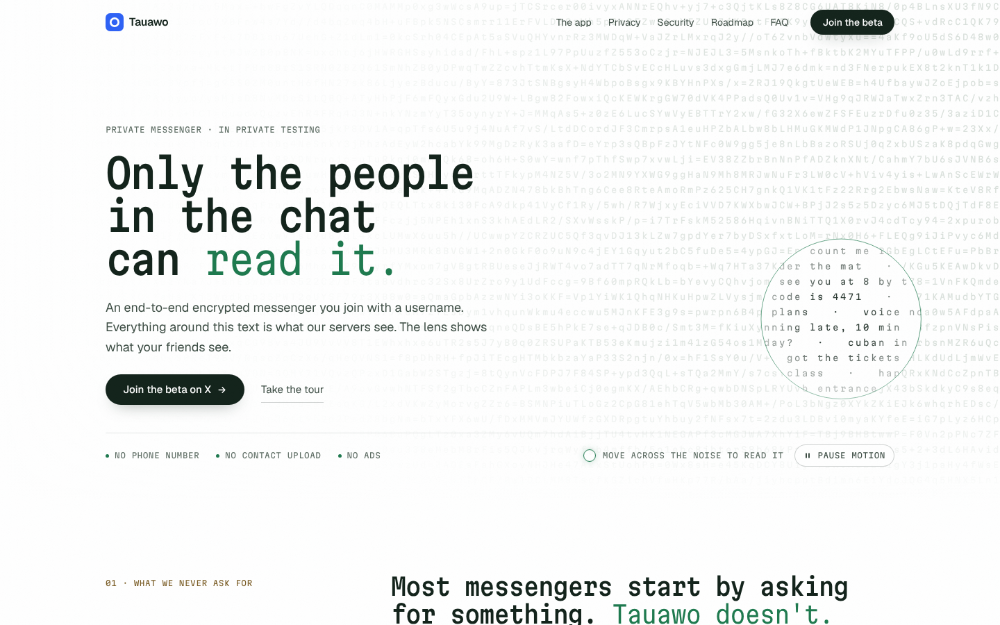
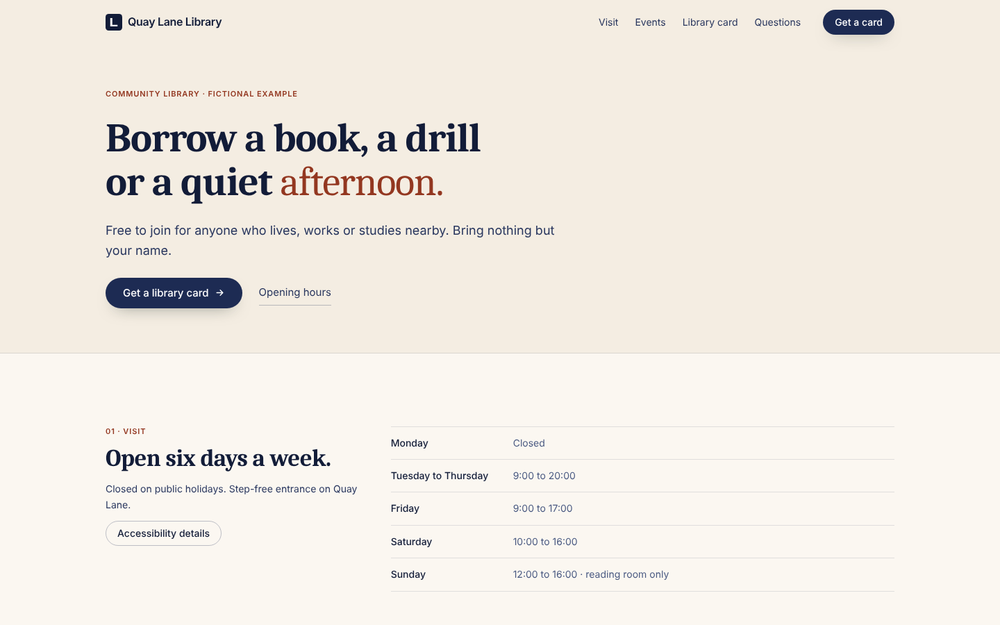

<div align="center">

# Larkmoor

**A small, accessible design system for building websites that look intentional and stay honest.**

Design tokens in the W3C community format · layout primitives · 17 accessible components · swappable brand themes · zero runtime dependencies

[](https://github.com/oddane/Larkmoor/actions/workflows/ci.yml)





<sub>Same components, two brands. Left: the Tauawo website (Evergreen theme). Right: a fictional example site (Harbor theme).</sub>

</div>

---

## Why Larkmoor

- **One source of truth.** Every colour, size, space, duration and layer is a [DTCG 2025.10](https://www.designtokens.org/TR/2025.10/) token. One dependency-free script builds CSS custom properties, themes, JSON and breakpoint constants from them.
- **Brands without forks.** A theme overrides semantic roles only. Components never change. Each theme is contrast-tested on its own, including dark themes.
- **Accessible by construction.** Native elements first, ARIA Authoring Practices patterns, visible focus, 24px+ targets, reduced motion, a pause control, forced-colours support and no-JavaScript fallbacks.
- **Private by default.** Self-hosted fonts, no cookies, no third-party requests. A test fails if a page ever calls another origin.
- **Proven, not promised.** 10 unit tests and 41 browser tests cover contrast, 17 screen widths, keyboard focus, interactions, network traffic, lab performance and visual regression.

## Quick start

### Plain HTML (no build tools)

Copy `dist/` into your site as `vendor/larkmoor/`:

```html
<html lang="en" data-lm-theme="harbor">          <!-- omit for the default Evergreen theme -->
<head>
  <script>document.documentElement.classList.add('js');</script>
  <link rel="stylesheet" href="vendor/larkmoor/larkmoor.css">
  <link rel="stylesheet" href="vendor/larkmoor/themes/harbor.css">
</head>
<body>
  <a class="lm-skip-link" href="#main">Skip to content</a>
  <main id="main">
    <section class="lm-section">
      <div class="lm-container lm-stack">
        <h1 class="lm-display">Hello, <em>Larkmoor.</em></h1>
        <p class="lm-lead">Tokens, primitives and components, themed in one attribute.</p>
        <div class="lm-cluster"><a class="lm-btn lm-btn--primary" href="#start">Get started</a></div>
      </div>
    </section>
  </main>
</body>
</html>
```

[`examples/harbor/index.html`](examples/harbor/index.html) is a complete page built exactly this way.

### With npm

The package is private and not on a registry. Install it straight from this repository:

```bash
npm install github:oddane/Larkmoor#v0.1.0
```

```js
import '@larkmoor/design-system/fonts.css';        // only if you use Geist / Martian Mono
import '@larkmoor/design-system/larkmoor.css';
import '@larkmoor/design-system/themes/harbor.css';
import { initHeader, initForm } from '@larkmoor/design-system';
import { below } from '@larkmoor/design-system/breakpoints';  // '(max-width: 899.98px)'
```

`npm run pack:check` proves this route: it installs the packed tarball into an empty project and resolves every entry point.

## What's included

| | |
|---|---|
| **Tokens** | palette, semantic colour roles, spacing (4px base), sizes, radii, borders, breakpoints (520 / 760 / 900 / 1100), type roles, motion, layers, elevation |
| **Themes** | `evergreen` (default), `evergreen-inverse`, `harbor`, `harbor-dark` |
| **Layout primitives** | container, stack, cluster, grid (+ fill), split, section, shell |
| **Components** | button, link, header and navigation, segmented control, accordion, field, input group, error summary, check, badge, panel, card, alert, rows, footer, progress, motion toggle |
| **Behaviours** | `initMotionToggle`, `initDisclosureMenu`, `initHeader`, `initReveal`, `initForm` (ES modules, TypeScript types) |
| **Fonts** | Geist and Martian Mono, self-hosted, SIL OFL 1.1 |

Browse every component with its states, keyboard behaviour and do/don't rules in the **component docs** ([`docs/index.html`](docs/index.html); run `npm run serve`).

## Development

Prerequisites: Node.js 20+ (`.nvmrc` pins 22).

```bash
npm install && npx playwright install chromium

npm run build          # tokens + CSS + JS -> dist/
npm run examples       # copy dist/ into the examples and docs
npm run serve          # http://127.0.0.1:4173/docs/ · /examples/tauawo/ · /examples/harbor/
npm test               # build, typecheck, unit + browser tests
npm run screenshots    # docs/screenshots/ at representative widths
npm run evidence       # snapshot the latest reports and logs into docs/evidence/
```

Edit `tokens/*.tokens.json` and `src/`. Never edit `dist/`, which is generated and committed so git installs work without a build.

## Repository layout

```
tokens/              DTCG sources: foundation/ → semantic/ → themes/
src/css/             base, typography, layout, components (order in index.txt)
src/js/              behaviours + type definitions
fonts/               woff2 files and their licences
dist/                generated package output
docs/                component docs (index.html), guides/, reports/, screenshots/, evidence/
examples/tauawo/     first consumer: the Tauawo website
examples/harbor/     second consumer: fictional library, different brand, no shared code
tests/               unit/, browser/, baselines/
scripts/             build, serve, sync, screenshots, pack check, GitHub setup
```

## Documentation

| Guides | Reports |
|---|---|
| [Design principles](docs/guides/DESIGN_PRINCIPLES.md) | [UI audit](docs/reports/UI_AUDIT.md) |
| [Guidelines: layout, spacing, type, content, motion, responsive](docs/guides/GUIDELINES.md) | [QA report](docs/reports/QA_REPORT.md) |
| [Theming](docs/guides/THEMING.md) | [Privacy evidence](docs/reports/PRIVACY_EVIDENCE.md) |
| [Accessibility](docs/guides/ACCESSIBILITY.md) | [Completion matrix](docs/reports/COMPLETION_MATRIX.md) |
| [Migration](docs/guides/MIGRATION.md) | [Changelog](CHANGELOG.md) |
| [Research and sources](docs/guides/RESEARCH.md) | [Security policy](SECURITY.md) |

Working with an AI assistant? Point it at [CLAUDE.md](CLAUDE.md) first.

## Versioning and releases

[Semantic versioning](https://semver.org/) on the public contract: class names, custom properties, token paths, theme names and JS exports.

- **Major:** something renamed or removed.
- **Minor:** something added.
- **Patch:** fixes that keep the contrast and size guarantees.

Tokens are deprecated with `$deprecated` for one minor release before removal.

To release:
1. Bump `version` in package.json.
2. Update CHANGELOG.md.
3. Push a `vX.Y.Z` tag.

The release workflow runs the full test suite and publishes a GitHub release with the package tarball.

## Repository settings (one-time, by the owner)

These need owner rights in the GitHub web interface:

1. **About** (gear icon on the repo page):
   - Description: "Accessible design system: DTCG tokens, layout primitives, components and themes."
   - Topics: `design-system`, `design-tokens`, `css`, `accessibility`, `wcag`.
2. **Releases → Draft a new release:**
   - Tag: `v0.1.0`, target `main`.
   - Title: "Larkmoor v0.1.0".
   - Notes: paste the 0.1.0 section of CHANGELOG.md.
   - Publish. The release workflow attaches the package tarball.
3. **Settings → General:**
   - allow squash merging only;
   - automatically delete head branches.
4. **Settings → Branches → Add rule for `main`:**
   - require the **Build and test** check;
   - require a pull request.

   On a free plan, rules on private repositories may need GitHub Pro.

With the GitHub CLI and admin rights, `REPO=oddane/Larkmoor scripts/github-setup.sh` does steps 1, 3 and 4.

## Contributing

See [CONTRIBUTING.md](CONTRIBUTING.md). Issues and pull requests use templates, and every change needs `npm test` to pass.

## Licence

Private. All rights reserved ([LICENSE.md](LICENSE.md)). Third-party fonts keep their own licences ([ATTRIBUTION.md](ATTRIBUTION.md)).
